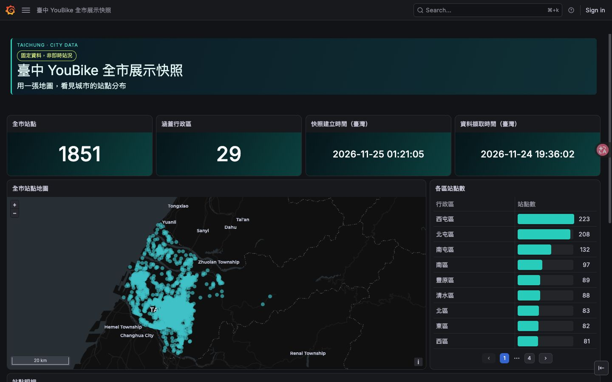

# 臺中 YouBike 全市站況與租借趨勢儀表板

以臺中市政府 YouBike 站點資料呈現全市最新站況、站點歷史與官方月報，並提供一份免登入的固定全市展示快照。



**[開啟免登入的全市展示快照（v2）](https://snapshots.raintank.io/dashboard/snapshot/c99414bd980a67f72ad3f0a159766685)**。此固定快照建立於2026-11-25 01:21:05，資料擷取時間為2026-11-24 19:36:02（臺灣時間），包含1,851站與29區；它不會隨本機採集更新。

## 專案功能

- 全市站點地圖、行政區站數、可借車／可還空位與來源時間。
- 臺灣時間早晚尖峰排行、行政區與站點篩選，以及單站歷史觀測。
- 官方全市月度租借趨勢，保留缺月資訊並標示來源與涵蓋期間。
- Grafana 原生免登入固定快照，供直接瀏覽全市總覽。

## 使用技術

| 項目 | 技術 |
| --- | --- |
| 儀表板與圖表 | Grafana 13.3 |
| 採集程式 | Python 3.13、psycopg 3 |
| 資料庫 | PostgreSQL 18 |
| 本機執行 | Docker Compose |
| 驗證 | Python `unittest`、隔離 PostgreSQL 整合驗證與 Grafana 畫面檢查 |

## 實作內容

- 約每十分鐘採集站點資料；同站與同來源時間只保留一筆，採集失敗時保留最後成功資料並記錄狀態。
- 以有效樣本計算尖峰缺車／缺位比例，分開處理兩種狀況，並以每站每尖峰至少24筆作為排行門檻。
- 匯入官方月報快照，保留原始來源與涵蓋月份，遇到缺月時在趨勢圖中斷線呈現。
- 將核准欄位整理成 Grafana 原生 Snapshot 資料，檢查快照固定性與輸出內容。

## 如何查看

- **免登入展示：**[全市固定快照（Grafana Snapshot）](https://snapshots.raintank.io/dashboard/snapshot/c99414bd980a67f72ad3f0a159766685)。
- **本機完整功能：**啟動後可查看[站點總覽](http://127.0.0.1:5088/d/taichung-youbike/taichung-youbike)、[早晚尖峰與單站歷史](http://127.0.0.1:5088/d/taichung-youbike-peaks/taichung-youbike)及[官方月報](http://127.0.0.1:5088/d/taichung-youbike-monthly/taichung-youbike)。本機版包含篩選與歷史資料；公開快照是固定日期的總覽。

## 本機啟動

需要 Docker、Docker Compose 和 OpenSSL。在專案根目錄執行：

```sh
./bin/local up -d --build --wait
```

啟動完成後，開啟[本機 Grafana 站點總覽](http://127.0.0.1:5088/d/taichung-youbike/taichung-youbike)。採集程式啟動時會先採集一次，之後約每十分鐘擷取；Grafana 畫面每分鐘更新。首次使用會建立本機 `.env` 憑證與 PostgreSQL volume。請保留兩者；既有 volume 若尚未套用新增資料結構，請依下方進階操作中的升級指引處理。

### 停止服務

```sh
./bin/local stop
```

此命令會停止 Compose 服務並保留 `.env` 與資料庫 volume。

### 再次啟動

```sh
./bin/local up -d --wait
```

### 查看採集紀錄

```sh
./bin/local logs --tail 40 collector
```

Grafana 預設只綁定本機 `127.0.0.1:5088`，以唯讀 Viewer 開啟；PostgreSQL 不公開主機連接埠。若5088已被占用，可設定 `YOUBIKE_GRAFANA_PORT` 指定其他本機連接埠。

<details>
<summary>進階操作、升級與驗證</summary>

## 來源與更新狀態

資料由[臺中市政府交通局](https://data.gov.tw/dataset/136781)提供，依政府資料開放授權條款第 1 版使用。各站「來源時間」為市府的站點資料時間，「最後成功採集」為本機完成並保存整批資料的時間，畫面皆使用臺灣時間。

如果抓取、資料驗證或儲存失敗，採集程式會記錄錯誤，並在下次排程再嘗試。只要資料庫可連線，就會更新採集狀態；最後一次成功快照仍可查看。資料庫無法讀取時，Grafana 會顯示資料來源錯誤。重抓同一站點與來源時間時，只保留一筆觀測。

## 採集程式測試

本票使用專案固定版本的 Python 容器執行既有15項採集單元測試、前置回歸測試及整合驗證，不需在主機安裝 `psycopg`。隔離目標與完整命令順序見下方「隔離整合驗證」。

## 早晚尖峰排行與單站歷史

從總覽上方「早晚尖峰與單站歷史」連結進入，或開啟[尖峰與歷史儀表板](http://127.0.0.1:5088/d/taichung-youbike-peaks/taichung-youbike)。選擇行政區、站點和右上方日期範圍；選單的 `All` 代表所有選項。站點以站號識別，選單顯示名稱及站號，已從最新快照消失的站點仍可從留存歷史查詢。

早尖峰為臺灣時間週一至週五 `07:00 ≤ 來源時間 < 09:00`，晚尖峰為 `17:00 ≤ 來源時間 < 19:00`。兩個尖峰在所選日期內各自累計。缺車比例為無車有效觀測數除以有效觀測數，缺位比例則以無位觀測分開計算。例如24筆中6筆無車、3筆無位，分別為25%與12.5%。每站、每個尖峰至少24筆才列入排行；23筆仍會出現在比例明細。

有效觀測須營運中，且來源時間不晚於首次採集時間、首次採集時來源年齡不超過30分鐘（正好30分鐘可計入）。重抓同一站號與來源時間只算一筆，資格依首次採集判定。停用、缺報、超時及未來時間不納入比例。缺報沒有觀測列，整批格式無效仍依既有採集失敗流程處理。這些比例描述已採集樣本，不代表完整時段的時間比例。

選擇一個站點即可查看所有時段的單站歷史觀測點與明細。歷史圖只繪製有效觀測點，不連線或推算缺報、停用等時段；明細保留不合格觀測及原因。零筆有效觀測或採集開始前的日期會顯示「無資料」；不補零，也不回填尚未採集的歷史。

### 已有第01版資料庫的升級

新 volume 啟動時會自動建立 `station_history` 檢視。既有 volume 不會重跑初始化；請先在原專案目錄明確套用下列新增檢視，再啟動或更新服務：

```sh
./bin/local exec -T db psql -v ON_ERROR_STOP=1 -U youbike_admin -d youbike < postgres/peak-history.sql
./bin/local up -d --build --wait
```

腳本只以交易建立或更新檢視並授予 `youbike_reader` 的 SELECT 權限，可重複執行，不改動既有觀測、站點總覽或採集狀態。套用失敗會回滾該交易；保留原 volume 和 `.env`，不要以刪除 volume 的方式升級。若只退回第01版程式，原資料與原總覽仍可使用，新增檢視可留存。

### 隔離整合驗證

`tests/integration_peak_history.py` 使用市府格式的本機 HTTP 測資，透過實際 `collector.main --once --source-url`、解析及資料庫寫入後，執行受版本控制的 Grafana SQL。HTTP server 在整合測試的 collector 容器內綁定 loopback，採集程式從同一容器連回，不需主機開 HTTP 連接埠。僅測試時替換採集時鐘以重現30分鐘與早晚尖峰邊界，正式採集程式沒有時鐘參數。

使用獨立 Compose project `taichung-youbike-ticket02-check` 和連接埠5092；Compose project、volume 與網路隔離資料，沿用 repo 根目錄的私有 `.env`。以下順序只啟動 `db grafana`，不啟動週期採集器。`./bin/local config --quiet` 只在缺少時建立 `.env` 並檢查 Compose 設定，不會啟動5088展示。接著在同一終端機設定同一份私有環境給 Compose 及整合容器使用：

```sh
ticket02_project=taichung-youbike-ticket02-check
./bin/local config --quiet
set -a
. ./.env
set +a
export YOUBIKE_GRAFANA_PORT=5092
docker compose --env-file .env -p "$ticket02_project" up -d --wait db grafana
docker compose --env-file .env -p "$ticket02_project" ps
docker compose --env-file .env -p "$ticket02_project" port grafana 3000
docker volume ls --filter "label=com.docker.compose.project=$ticket02_project"
```

確認 `ps` 顯示專案 `taichung-youbike-ticket02-check` 的 `db`、`grafana` 服務，`volume ls` 顯示同專案標籤的資料庫 volume，且 `port` 顯示 Grafana 綁定 `127.0.0.1:5092`。確認目標後，在同一終端機為該隔離資料庫設定標記，再建置採集容器並執行測試：

```sh
ticket02_project=taichung-youbike-ticket02-check
set -a
. ./.env
set +a
export YOUBIKE_GRAFANA_PORT=5092
docker compose --env-file .env -p "$ticket02_project" exec -T db \
  psql -v ON_ERROR_STOP=1 -U youbike_admin -d youbike \
  -c "COMMENT ON DATABASE youbike IS 'ticket02-check disposable verification';"
docker compose --env-file .env -p "$ticket02_project" build collector
docker compose --env-file .env -p "$ticket02_project" run --rm --no-deps -T \
  -v "$PWD/tests:/app/tests:ro" -v "$PWD/grafana:/app/grafana:ro" \
  collector python -B -m unittest discover -s tests -v
docker compose --env-file .env -p "$ticket02_project" run --rm --no-deps -T \
  -e TICKET02_DISPOSABLE=ticket02-check -e YOUBIKE_READER_PASSWORD \
  -v "$PWD/tests:/app/tests:ro" -v "$PWD/grafana:/app/grafana:ro" \
  collector python -B tests/integration_peak_history.py
```

識別標記只設定在這個隔離資料庫；不可對一般展示資料庫執行。測試命令在容器內執行，不會輸出 `.env` 內容。

整合測試在 HTTP fixture 送出前核對資料庫標記、測資站號與 `youbike_collector`／`youbike_reader` 身分；以唯讀查詢檢查採集表、`current_stations`、`station_history` 及兩張 dashboard 的實際查詢。Stat reducer 檢查使用 reader 查詢回傳的欄位型別與欄名，不能以這些 SQL 檢查代替 Grafana 畫面驗收。預期保留442筆觀測，可在同一隔離資料庫重跑以驗證去重，不需清除資料。測試涵蓋30分鐘內／等於／超過、未來來源時間、停用、缺報、無效批次復原、早晚與週末邊界、23／24筆、比例、篩選、點狀歷史與單站明細。

### Grafana 畫面驗收與證據

使用已授權的本機瀏覽器工具操作5092上的實際 Grafana；僅在完整畫面證據可讀時記錄通過。遇到瀏覽器限制時保留阻擋並回報，使用者恢復控制後再繼續。每次選擇行政區、站點或日期後，等待受影響面板完成載入並呈現新選擇的結果，再保存證據。每份證據記錄程式版本或未提交來源檔雜湊、Compose project／目標 URL、Grafana 角色、所選行政區與站號、精確日期範圍，以及完整可獨立閱讀的 DOM 或 AX 狀態；若只保存差分，須同時保存其完整基準。主張圖表外觀或點線行為時一併保存截圖。

將完整原始狀態與截圖保存在本票既有的 `../.scratch/taichung-youbike/review/02/` 驗收目錄，保留必要 metadata；對話與摘要只引用檔名和關鍵觀察，不重複貼出整份 DOM、AX 或報告。驗收至少涵蓋：

第一次可用的單站歷史圖驗證，先完成下表站點 A 長空檔與 CLOCK 營運中／停用／營運中案例，等待結果更新並保存完整狀態與截圖，再進行其餘驗收案例。

| 操作 | 畫面結果 |
| --- | --- |
| 西屯區站點 B，2026-11-16–2026-11-18 | 早、晚各23筆，不列排行；比例明細各23筆、歷史46筆。 |
| 北區站點 C，2026-11-16–2026-11-18 | 早、晚排行各24筆、歷史48筆。 |
| 北區站點 C，2026-11-16–2026-11-17 | 早、晚各12筆、不列排行；明細各12筆、歷史24筆。 |
| 西屯區站點 A，涵蓋兩天 | 早尖峰24筆、缺車25%／缺位12.5%；晚尖峰24筆、缺車50%／缺位25%；歷史48個有效點，08:50至17:00長空檔沒有連線或補值。 |
| 站點 CLOCK，2026-11-22 09:55–10:25 | 歷史圖只顯示2個有效點；明細保留3筆及中間停用原因。 |
| 零筆及採集前日期（2020-01-01–2020-01-02） | 顯示「無資料」。 |
| 停用站 T02-INACTIVE，2026-11-16–2026-11-18 | 全部48筆不合格，歷史圖無點，狀態提示不合格；明細保留原因。 |
| 站點選擇 All | 未選單一站點時顯示先選站提示。 |
| 總覽與尖峰歷史 | 實際操作連結來回切換，確認兩個方向都開啟正確儀表板。 |

完整狀態需包含當次選擇及完成更新後的面板內容。保留原始檔供 Spec／Review 獨立讀取；只在驗收記錄中摘要各項結果。

## 官方全市租借月度趨勢

開啟[官方全市租借月報](http://127.0.0.1:5088/d/taichung-youbike-monthly/taichung-youbike)，也可用 Grafana 搜尋「臺中 YouBike 官方全市租借月報」。頁首先呈現最新官方月份、當月租借車次、已發布月數及涵蓋期間，主圖以青藍色圓點折線呈現月度趨勢；下方保留來源、核對日期、本機觀測期間與官方明細。月報頁可前往站點總覽及尖峰歷史。新 volume 首次啟動即載入快照，不需等待站點採集；既有 volume 請先依下節升級。

月報使用[臺中市政府交通局租賃月報（資料集88614）](https://data.gov.tw/dataset/88614)，依政府資料開放授權條款第1版使用。只取「臺中市／月／公共自行租賃情形－租借車次」，月份依原始「資料時間日期」判定，單位為車次。本版於2026-11-24核對：2025-02至2026-09，共18個已發布月份；2025-10、2026-01在本次資料集入口未列資源，圖表保留缺月、明細標示「未發布（本次核對未列）」，不補零或推估。2026-09為2,091,631車次。

這是隨專案附帶、由管理者載入的官方快照，不會自動下載新月報。`postgres/official-monthly.sql` 每月保留原始JSON網址、原始檔SHA256及核對日期，明細可開啟每月原始資料。主圖使用原生XY時間軸，顯示整份快照，不受 Grafana 最近14天等日期範圍隱藏。只有官方已發布月份會畫圓點；依實際月份動態分成連續區段，各區段獨立連線，缺月不補零、不跨段連線。滑過圓點可看精確租借車次，完整明細仍保留兩個缺月的NULL與未發布標示。

月報與[站況資料集136781](https://data.gov.tw/dataset/136781)各自標示來源及期間。站點來源時間以臺灣時間顯示，從本機首次成功採集開始累積；尚無觀測時明確提示。站點觀測數、車數或空位皆不等於實際租借車次，不用來推算官方月報。

### 已有 volume 的月報升級與復原限制

既有 volume 不重跑初始化。先保留原 volume、私有 `.env` 及既有資料庫備份；第01版 volume 也須先完成上方 `peak-history.sql` 升級，讓月報頁可讀取站點觀測期間。再於原專案目錄明確執行：

```sh
./bin/local exec -T db psql -v ON_ERROR_STOP=1 -U youbike_admin -d youbike < postgres/official-monthly.sql
./bin/local up -d --build --wait
```

本 SQL 在同一筆交易中新增月報表、載入快照及授予 reader 的 SELECT；同月份以主鍵更新，可重跑，不更動站點觀測、尖峰檢視或採集狀態，collector沒有月報寫入權限。失敗時整筆交易回滾，`ON_ERROR_STOP` 會回報失敗。成功載入會更新相同月份的快照；日後若要復原已成功更新的月報值，須使用先前備份或先前核對的快照重新載入，退回程式碼不會自動回復資料。退回舊版程式可保留新增表，不需刪表或 volume。

Grafana 的三張 JSON 各自以唯讀單檔掛載，由既有 provisioning 掃描同一目錄；如此可在更新服務時加入月報，而不修改兩張既有儀表板的內容。修改 Compose 不會自動套用到已運行的服務；5088展示與5092舊驗證仍需另行明確升級，不應從本票的隔離測試推論已部署。

### 第03張隔離驗證

使用專用 project `taichung-youbike-ticket03-check`、Grafana連接埠5093與其獨立 `pgdata`。不得重用5088／5092、刪除 volume 取得乾淨狀態或繞過 guard。先確認私有 `.env` 存在，僅在缺少時執行 `./bin/local config --quiet`；下列命令不啟動週期採集器：

```sh
ticket03_project=taichung-youbike-ticket03-check
set -a
. ./.env
set +a
export YOUBIKE_GRAFANA_PORT=5093
docker compose --env-file .env -p "$ticket03_project" up -d --wait db grafana
docker compose --env-file .env -p "$ticket03_project" ps
docker compose --env-file .env -p "$ticket03_project" port grafana 3000
docker volume ls --filter "label=com.docker.compose.project=$ticket03_project"
```

確認專案的 `db`／`grafana`、同標籤volume及 `127.0.0.1:5093`；第一個測試寫入前亦須確認本次來源版本、測試image及空站點狀態，才設定專屬標記。月報整合程式會在任何測試寫入前核對標記、資料庫名稱、current/session actor及站號；僅允許空站點或第02張定義的受控 `T02-*` 測資。

```sh
docker compose --env-file .env -p "$ticket03_project" exec -T db \
  psql -v ON_ERROR_STOP=1 -U youbike_admin -d youbike \
  -c "COMMENT ON DATABASE youbike IS 'ticket03-check disposable verification';"
docker compose --env-file .env -p "$ticket03_project" build collector
docker compose --env-file .env -p "$ticket03_project" run --rm --no-deps -T \
  -v "$PWD/tests:/app/tests:ro" -v "$PWD/grafana:/app/grafana:ro" \
  -v "$PWD/postgres:/app/postgres:ro" \
  collector python -B -m unittest discover -s tests -v
docker compose --env-file .env -p "$ticket03_project" run --rm --no-deps -T \
  -e TICKET03_DISPOSABLE=ticket03-check -e YOUBIKE_READER_PASSWORD -e YOUBIKE_ADMIN_PASSWORD \
  -v "$PWD/tests:/app/tests:ro" -v "$PWD/grafana:/app/grafana:ro" \
  -v "$PWD/postgres:/app/postgres:ro" \
  collector python -B tests/integration_official_monthly.py --admin
```

不加 `--admin` 時只跑 reader 面板SQL、月份／缺月／官方抽查值、來源期間與reader／collector寫入拒絕；加上該參數才以明確admin actor執行實際seed兩次、同腳本失敗副本回滾、月初／非負約束與站點／採集狀態不變檢查。此測試不輸出憑證，也不新增站點資料。

Grafana實際驗收仍遵循上方完整原始DOM／AX及截圖程序，改用5093並保存在 `../.scratch/taichung-youbike/review/03/`：首次0站點歷史可見四張KPI與18個官方月份圓點、2026-09數值與hover精確值；兩個缺月前後斷線，明細仍保留缺月與未發布標示；各自來源／涵蓋期間，以及月報前往原有兩頁的連結與其無資料行為。亦以既有最近6小時URL日期範圍重新開啟，確認主圖仍呈現整份月報。SQL／metadata通過不能代替畫面驗收。

## 免登入的全市展示快照

公開版是 Grafana 原生 Snapshot，只呈現固定全市總覽：站點與行政區數、地圖、各區站數、站點明細、快照建立時間、資料擷取時間、各站來源時間及來源授權。它不連回資料庫，也不隨本機採集更新；尖峰、歷史篩選與官方月報仍由本機版提供。

目前[公開快照連結](https://snapshots.raintank.io/dashboard/snapshot/c99414bd980a67f72ad3f0a159766685)為v2；[個人網站作品區](https://a9088391.github.io/#projects)的「開啟展示」已更新到此連結，並已從未登入的公開網站實測抵達。v2包含1,851站與29區，建立時間2026-11-25 01:21:05、資料擷取時間2026-11-24 19:36:02（臺灣時間）。`expires=0`（Never）服務回傳的 `meta_expires` 是 `2076-11-12T05:21:06Z`；這是服務回傳的UTC期限，不保證第三方服務永久可用。v1快照仍保留歷史連結，不覆寫或刪除。

v1重新檢查時匿名API仍回傳相同資料，但瀏覽器只顯示Grafana外殼，沒有面板；根因未確認。v2公開畫面已通過匿名首次載入、地圖縮放與tooltip、行政區及站點表末頁、來源資訊和手機視窗檢查；console仍記錄 `Error fetching Prometheus write target` 與 `Object`，根因未確認，不宣稱無console錯誤。網站科技藍改版已於2026-11-25發布（網站提交 `3d94795d671f266c3b96c86926ed08f311680ca2`），七項作品都有可展開的實際截圖；取得專案的人可查看展示，或依「本機啟動」操作完整功能。

本票隔離環境運行時，也可[開啟v2本機固定快照預覽](http://127.0.0.1:5095/dashboard/snapshot/4SpYO31VXqAsMRxhAab9thhiDzs224sr)；它需本機5095服務運行，容器重建後可能失效，這不是公開連結。

`public_snapshot.py` 只有 `prepare`／`check`，不發送 HTTP、不發布。`prepare` 限用 `youbike_reader`，在同一唯讀、可重複讀取交易內擷取成功狀態與全市資料；要求29區完整且有資料，將公開欄位建成Grafana原生 `snapshotData` frames。v1與v2使用版本化儀表板模板；`check` 只接受 `version` 恰為整數1或2的支援模板，並依固定面板白名單重建比對，拒絕空資料、缺區、重複站號、不合法欄位、錯誤時間、不同步面板、任意查詢／資料源／隱藏metadata／連結／刷新設定。輸出以排他建立保護既有檔，不會覆寫舊候選。一般dashboard JSON export沒有這些資料，不能代替含資料快照。

### 第04張隔離準備與驗證

使用本票唯一專用 project `taichung-youbike-ticket04-check`、Grafana `127.0.0.1:5095` 與同project的 `pgdata`。不重用5088／5092／5093／5094，不啟動週期採集器、不刪volume。先確認私有 `.env` 存在；僅缺少時才執行 `./bin/local config --quiet`。

```sh
ticket04_project=taichung-youbike-ticket04-check
set -a
. ./.env
set +a
export YOUBIKE_GRAFANA_PORT=5095
docker compose --env-file .env -p "$ticket04_project" up -d --wait db grafana
docker compose --env-file .env -p "$ticket04_project" ps
docker compose --env-file .env -p "$ticket04_project" port grafana 3000
docker volume ls --filter "label=com.docker.compose.project=$ticket04_project"
docker compose --env-file .env -p "$ticket04_project" exec -T db \
  psql -X -v ON_ERROR_STOP=1 -U youbike_admin -d youbike \
  -c "SELECT current_database(),current_user,session_user,(SELECT count(*) FROM station_observations),shobj_description(oid,'pg_database') FROM pg_database WHERE datname=current_database();"
```

第一個寫入前，核對實際project／service標籤、loopback5095綁定、同project volume、來源版本及測試image；DB須為 `youbike`、current/session actor皆 `youbike_admin`、空站點且尚無標記。只有以上都符合，才設定標記；若非空或已有其他標記就停止，不能繞guard或清資料。

```sh
docker compose --env-file .env -p "$ticket04_project" exec -T db \
  psql -X -v ON_ERROR_STOP=1 -U youbike_admin -d youbike \
  -c "DO \$\$ BEGIN IF current_database() <> 'youbike' OR current_user <> 'youbike_admin' OR session_user <> 'youbike_admin' OR (SELECT count(*) FROM station_observations) <> 0 OR shobj_description((SELECT oid FROM pg_database WHERE datname=current_database()), 'pg_database') IS NOT NULL THEN RAISE EXCEPTION 'ticket04 target guard rejected'; END IF; END \$\$; COMMENT ON DATABASE youbike IS 'ticket04-check disposable verification';"
docker compose --env-file .env -p "$ticket04_project" build collector
docker compose --env-file .env -p "$ticket04_project" run --rm --no-deps -T \
  -e TICKET04_DISPOSABLE=ticket04-check \
  -v "$PWD/tests:/app/tests:ro" -v "$PWD/public_snapshot.py:/app/public_snapshot.py:ro" \
  collector python -B -c 'import sys; sys.path.insert(0,"tests"); from integration_public_snapshot import guard; import collector,psycopg; guard(); c=psycopg.connect(connect_timeout=5); assert c.execute("SELECT count(*) FROM station_observations").fetchone()[0] == 0; c.close(); sys.exit(collector.main(["--once"]))'
```

上述一次採集會連向市府官方資料；既有collector寫入整批資料，沒有週期排程。後續重跑驗證直接從下列步驟繼續，不重設標記、不重跑只接受空庫的初次採集。

```sh
mkdir -p ../.scratch/taichung-youbike/review/04
docker compose --env-file .env -p "$ticket04_project" run --rm --no-deps -T \
  -e PGUSER=youbike_reader -e PGPASSWORD="$YOUBIKE_READER_PASSWORD" \
  -v "$PWD/public_snapshot.py:/app/public_snapshot.py:ro" \
  -v "$PWD/../.scratch/taichung-youbike/review/04:/evidence" \
  collector python -B public_snapshot.py prepare /evidence/public-snapshot.json
python3 -B public_snapshot.py check ../.scratch/taichung-youbike/review/04/public-snapshot.json
docker compose --env-file .env -p "$ticket04_project" run --rm --no-deps -T \
  -v "$PWD/tests:/app/tests:ro" -v "$PWD/grafana:/app/grafana:ro" \
  -v "$PWD/postgres:/app/postgres:ro" -v "$PWD/public_snapshot.py:/app/public_snapshot.py:ro" \
  collector python -B -m unittest discover -s tests -v
docker compose --env-file .env -p "$ticket04_project" run --rm --no-deps -T \
  -e TICKET04_DISPOSABLE=ticket04-check -e YOUBIKE_READER_PASSWORD \
  -v "$PWD/tests:/app/tests:ro" -v "$PWD/public_snapshot.py:/app/public_snapshot.py:ro" \
  collector python -B tests/integration_public_snapshot.py
```

`prepare` 不覆寫既有候選；保留原檔／雜湊，下一份另取檔名。唯讀整合檢查以真實reader逐站逐欄比對native frames、站數與區數。建立本地原生快照的API步驟、發布前審查及撤銷限制見[快照操作文件](docs/public-snapshot.md)。本票本地API只准 `external=false`；不能把外部上傳當相容性探測。

### 第04張 Grafana 畫面與固定性證據

仍遵循上方「Grafana 畫面驗收與證據」的完整原始AX／DOM／JPG程序，改用5095本地 Snapshot URL，保存至 `../.scratch/taichung-youbike/review/04/`。記錄實際候選檔SHA256、程式／測試來源雜湊、Grafana版本、project、URL、匿名角色及資料時間。

先保存未登入首次載入：四張KPI、29區、全市地圖、固定資料提示與日期。實際縮放地圖、指向至少一站，核對站名、可借／可還、營運狀態與來源時間；翻閱站點明細與各區表格，確認來源／授權連結及固定日期，不出現月報／尖峰／篩選入口或即時更新誤解。保留完整狀態與必要JPG；SQL／API／metadata預檢不代替這些畫面檢查。

首次證據保存後，以該本地快照的公開key執行一次新採集（只用key，不填deleteKey）：

```sh
docker compose --env-file .env -p "$ticket04_project" run --rm --no-deps -T \
  -e TICKET04_DISPOSABLE=ticket04-check -e YOUBIKE_READER_PASSWORD \
  -v "$PWD/tests:/app/tests:ro" -v "$PWD/public_snapshot.py:/app/public_snapshot.py:ro" \
  collector python -B tests/integration_public_snapshot.py \
  --snapshot-key 4SpYO31VXqAsMRxhAab9thhiDzs224sr --recollect
```

整合程式在任何寫入前核對環境標記、DB名稱、current/session collector actor；走實際 `collector.main --once`，確認最後成功採集時間前進、同一本地快照匿名API回應逐位元不變且日期不變。2026-11-25的v2本機固定性檢查已通過：1,851站／29區重新採集後，同一5095快照API回應SHA256仍為 `a115dff97443207158b829ec3551869702664481b43343c49125d6b19754a800`，匿名頁面重新載入仍顯示相同站數、建立時間2026-11-25 01:21:05及資料擷取時間2026-11-24 19:36:02（臺灣時間）。原始畫面證據保存在本票驗收目錄。v1的三項公開驗收保留為歷史結果，不代表v2通過；v2的三項公開驗收均已通過：

- **v2公開驗收通過：**未登入開啟官方服務URL，核對全市總覽、日期、來源及原生面板互動。
- **v2公開驗收通過：**本機再次採集後，同一v2公開URL的匿名API回應及日期不變；重新載入畫面仍顯示原快照時間。
- **v2網站入口驗收通過：**網站提交 `b13277a4d69367eeaff04d893aab06847d073ff9` 的Pages部署成功；從未登入的公開作品區另開新分頁可抵達同一v2快照，標題、站數、日期與來源正確，原作品頁保留。

v2候選 `public-snapshot-v2-r2.json` 的SHA256為 `11765db86444494ffdf251926e03bd25c35bfcdd06b0efbf0a905706de7dfc2f`，已依核准雜湊單次發布；官方服務版本 `13.4.0-44540513276` 回覆HTTP 200。匿名公開API回應為413,980 bytes、SHA256 `7a45a53f549b378417357f542b63fb8a26c177da3abf42cb5689e82a9c2113bd`；其中核准候選的dashboard欄位一致，服務僅加入 `snapshot.originalUrl=""`。服務回傳 `meta_created=2026-11-25T05:21:06Z`、`meta_expires=2076-11-12T05:21:06Z`（UTC）。發布URL為[新版公開快照](https://snapshots.raintank.io/dashboard/snapshot/c99414bd980a67f72ad3f0a159766685)。未來其他候選仍須重新審查並另取核准；v1 URL與內容保留不變。

本次v2網站入口的Pages run `45555845226` 成功，正式網站桌面與375px受影響卡片及另開分頁抵達已驗證；原始AX／DOM／JPG與提交身分保存在本票 `restyle-20261125/publication-v2/`。YouBike repo本輪尚未獲准commit／push，以上文件更新仍保留於本機。

</details>
